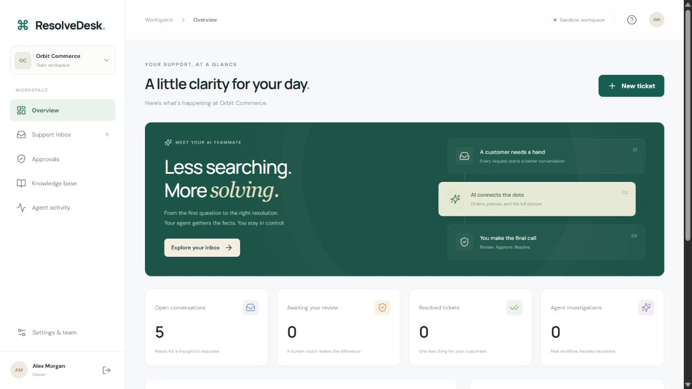

# ResolveDesk

**An AI support workspace where the agent investigates and a human makes the call.**

Next.js / TypeScript · FastAPI / Python · PostgreSQL / SQLite · LangChain · LangGraph · AWS infrastructure

ResolveDesk is a working local-first support SaaS portfolio project. It has real sessions, organization and customer isolation, a customer portal, support inbox, knowledge sources, durable agent investigations, approval workflows, sandbox actions and an audit trail. The keyless demo runs a **real LangGraph graph with deterministic decisions**. Optional LLM mode uses a **LangChain tool-calling agent**. The default demo does not pretend to call a model.



See the [approval workflow](docs/screenshots/approval-workflow.png), [customer portal](docs/screenshots/customer-orders.png) and [morning walkthrough](MORNING.md).

## Start on Windows

If dependencies are already installed, double-click **START.cmd**, then open **http://127.0.0.1:3000**. Startup runs API and frontend processes in the background, waits until both are healthy and writes logs under `data/`. A packaged production build is used when present; use `start.ps1 -Dev` for hot reload.

```powershell
# First-time setup if needed (Python 3.12+, Node 20.9+)
.\scripts\setup.ps1
.\scripts\start.ps1
# Later
.\scripts\stop.ps1
# Rebuild the fast production demo after editing
.\scripts\build.ps1
# Or start with hot reload while developing (after stopping existing servers)
.\scripts\start.ps1 -Dev
```

PowerShell execution policy preventing scripts? Use `SETUP.cmd`, `START.cmd` and `STOP.cmd`; these only set the execution policy for that individual process.

| Account | Email | Password | Can do |
|---|---|---|---|
| Owner | `owner@orbit.demo` | `DemoPass123!` | Investigate, approve, manage accounts |
| Support agent | `agent@orbit.demo` | `DemoPass123!` | Investigate and reply; cannot approve |
| Customer | `priya@orbit.demo` | `DemoPass123!` | Own tickets and orders only |
| Other customer | `jordan@orbit.demo` | `DemoPass123!` | Separate customer scope |
| Other tenant owner | `owner@northstar.demo` | `DemoPass123!` | Northstar data only |

Quick demo buttons are available on the login page while demo seeding is enabled. These are synthetic accounts/data. A new workspace can also be registered from the login screen.

## The five-minute demo

1. Sign in as the Orbit owner. Open **Support inbox**.
2. Open **Payment went through, but my order never arrived** (`RD-1042`).
3. Select **Run investigation**. Watch the trace populate with classification, policy evidence and the verified order.
4. The graph pauses at a durable `interrupt()`. No financial action has executed.
5. Review the policy excerpts and approve the sandbox refund.
6. The workflow resumes, revalidates the order, records exactly one sandbox action and posts the reviewed response.
7. Sign in as Priya. See the response and the order's refunded payment status.
8. Try the 45-day keyboard refund or duplicate-charge ticket: both escalate.
9. Sign in as the support agent: the approval controls are unavailable and the API also rejects approval.
10. Sign in to Northstar: Orbit tickets, runs, documents and orders are inaccessible.

For a restart demo, stop the app while a proposal awaits approval, restart it, then approve the same proposal. State is checkpointed in a separate SQLite database (or PostgreSQL with Docker).

## PostgreSQL + pgvector with Docker

```powershell
Copy-Item .env.example .env
docker compose up --build -d
```

Open http://localhost:3000. API docs: http://localhost:8000/docs. PostgreSQL is internal to the Docker network; it is not published to the host. Run `docker compose down` to stop while retaining the database volume. Do not run native startup and Docker on the same ports simultaneously.

Local Python uses SQLite by default so Docker Desktop is not needed to try the app. The same SQLAlchemy models support PostgreSQL. Docker Compose also stores LangGraph checkpoints in PostgreSQL. Optional embeddings use pgvector; the default retrieval is keyword-based and does not spend API credits.

## Enable live AI

Set environment variables in your terminal before starting, or create `backend/.env`:

```dotenv
AGENT_MODE=llm
OPENAI_API_KEY=your-key-here
OPENAI_MODEL=gpt-4.1-mini
LANGSMITH_TRACING=true
LANGSMITH_API_KEY=your-langsmith-key
LANGSMITH_PROJECT=resolvedesk
```

`OPENAI_MODEL` is configurable; use a model available to your account that supports tool calling and structured output. Live calls incur provider charges. No credentials are bundled or committed. LangSmith tracing is opt-in; traces can include ticket/document content, so enable it only for data you intend to send there.

For semantic retrieval, use PostgreSQL and set `EMBEDDINGS_ENABLED=true` plus an OpenAI key. Index existing knowledge sources with:

```powershell
cd backend
..\.venv\Scripts\python.exe -m app.index_knowledge
```

Newly added documents are indexed automatically when enabled. SQL stores the source text; pgvector stores its embedding. Queries combine keyword overlap with semantic scores. This initial version indexes each document as one unit; add chunking/reranking for larger corpora.

## Validation

```powershell
cd backend
..\.venv\Scripts\python.exe -m pytest
..\.venv\Scripts\python.exe -m app.evaluate
cd ../frontend
npm run build
```

The integration suite covers authentication, tenant/customer isolation, approval roles, refund policy, rejection, duplicate execution prevention, current-state revalidation, file validation and checkpoint persistence across processes. The evaluation script reports deterministic category and policy-boundary checks, **not LLM accuracy**. See `docs/verification.md` for what was actually run in this build.

## Repository map

```text
backend/app/           FastAPI, SQLAlchemy, auth, LangGraph, retrieval
backend/tests/         Integration and policy tests
frontend/app/          Next.js workspace and customer portal
frontend/lib/          API client and formatting
infra/terraform/      AWS ECS/Fargate, RDS, ALB, ECR, S3, IAM, logs
scripts/              Windows setup/start/stop helpers
docs/                 Architecture, deployment, demo and roadmap
.github/workflows/    Backend tests and frontend production build
```

## Honest boundaries

- Financial actions are simulated database changes. There is no real payment gateway, email sender or order-provider integration.
- Local background jobs run in one API process, with a persistent run table, restart recovery and serialized graph execution. There is no distributed worker queue yet.
- Schema creation is automated for this initial version. Versioned Alembic migrations, production identity/email verification, shared rate limits, reset-password flows and invitation emails are roadmap items.
- `.txt` and `.md` uploads work. PDF/OCR ingestion is not implemented.
- The account-help demo refers customers to their **store's** reset-password page; ResolveDesk itself does not yet implement password reset.
- Cloud files are a deployment scaffold, not a claim that AWS resources were provisioned. See `docs/deployment.md` before deployment.

## Git

The project is a local Git repository on `codex/initial-build`. No remote is required. After creating an empty remote repository:

```powershell
git remote add origin <your-repository-url>
git push -u origin codex/initial-build
```

Never commit `.env`, credentials, local databases or Terraform state.
