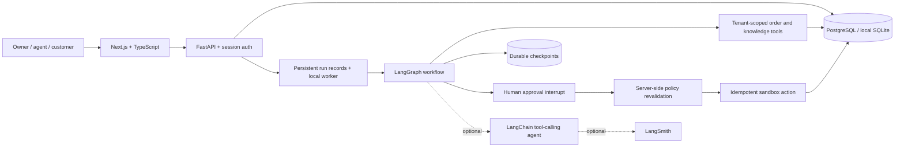

# Architecture and design decisions

## Request boundaries

Authentication uses random opaque session tokens in an HttpOnly, SameSite=Lax cookie. The database stores token hashes and expiration, never raw session tokens. Passwords use salted PBKDF2-HMAC-SHA256. The backend scopes access using the authenticated user's organization, not a client-supplied organization ID. Customer ticket and order reads also require matching customer ID. Staff-only endpoints expose internal evidence and run state. Only owners can approve, decline, delete knowledge or create accounts.

Unsafe browser requests check the Origin allowlist. Production cookies require HTTPS. The app is intended to run UI and API behind the same origin (Next rewrites locally, ALB path routing in AWS). The in-memory login attempt limiter is a development control; move it to shared infrastructure before internet-scale operation.

## Stateful execution

The graph is `classify → investigate → review → execute`. Demo decisions are deterministic. LLM mode runs a bounded LangChain agent with two read-only tools, then feeds its structured recommendation through backend policy checks. These tools capture tenant/customer scope in server-side closures; the model cannot select an arbitrary organization or customer.

`review` calls `interrupt()`. The run ID is the LangGraph thread ID. A persistent SQLite saver is used locally, a Postgres saver in Docker/AWS. The pending approval is a durable business record separate from the checkpoint. Approval transitions the run to queued in the same database commit as the decision. Startup recovers queued/running jobs. Awaiting-approval jobs stay paused until a decision.

The worker is deliberately single-process and serialized with a lock. Within that deployment, API mutations are serialized for run creation/approval. PostgreSQL order row locking and a unique action idempotency key prevent replayed refunds. The action, customer response, ticket state, audit event and completed run are committed together. Graph trace events deduplicate by run/step. A crash after committing an action but before checkpointing can replay the node safely.

This is not a distributed job queue. Multiple API processes/replicas are unsupported because run-enqueue exclusion is currently process-local. The Terraform module enforces 0/1 service replicas and replaces tasks without an overlap. The next scaling step is an SQS worker with a transactional outbox, per-ticket active-run uniqueness and distributed run claims/leases.

## Policy and evidence

The demo refund policy is explicit backend code: verified paid order, undelivered/processing/damaged, 0–30 days, owner approval. Duplicate/unauthorized charge cases escalate. The execution node reads current order state again. The model never controls refund amounts or destination accounts. A knowledge document may explain policy but cannot change authorization or this eligibility function.

Retrieval defaults to tenant-scoped keyword overlap with evidence snippets. Optional PostgreSQL/pgvector search adds OpenAI embeddings. The first version embeds each document as one unit and stores original source text in SQL. S3 optionally archives original text documents in a private bucket; it is not the query database. Larger corpora need chunking, hybrid ranking calibration, index monitoring and source-version snapshots.

LLM output can still contain unsupported prose. Human review is mandatory for all proposed responses/actions in this version. The backend's hard authorization and financial checks are enforced independently; universal hallucination or prompt-injection prevention is not claimed.

## Frontend behavior

The Next.js UI is a responsive workspace with overview, inbox, approvals, knowledge, runs, team/settings and a customer portal. State comes from the API, not hard-coded dashboard metrics. Polling updates selected tickets every two seconds and workspace data every five seconds. Live SSE/WebSocket streaming is a future improvement. React escapes ticket/source text; the app never renders untrusted raw HTML.
